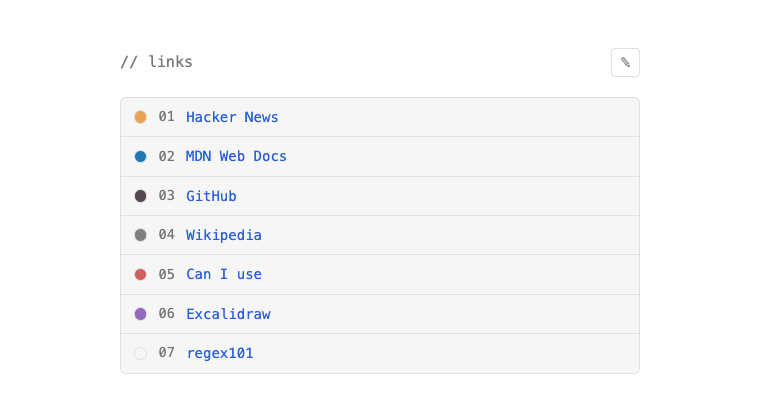
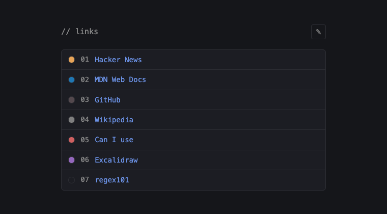
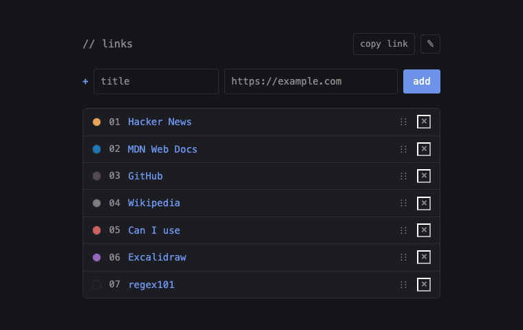

# linkshelf

Clean and simple URL bookmarking site. No backend, no account, no storage: the whole list lives in the URL. Bookmark it or send it to someone, and they get the same list.

| Light | Dark |
| --- | --- |
|  |  |

Edit mode (✎) lets you add, rename, recolor, reorder and remove links, and copy the share link:



## Features

- Add links with a title and a color  
- Click a title in edit mode to rename it or change its URL (Enter saves, Esc cancels)
- Click the dot to pick a color from the palette or set a custom one
- Drag the `⋮⋮` handle to reorder
- **copy link** puts the current list's URL on the clipboard
- Follows the system light/dark theme

## How it works

The links are stored as a base64url-encoded JSON array in the URL path:

That path decodes to the sample list in the screenshots:

```json
[
  { "t": "Hacker News",  "u": "https://news.ycombinator.com/", "c": "#e7a458" },
  { "t": "MDN Web Docs", "u": "https://developer.mozilla.org/", "c": "#1f77b4" },
  { "t": "GitHub",       "u": "https://github.com/",            "c": "#53484d" },
  { "t": "Wikipedia",    "u": "https://en.wikipedia.org/",      "c": "#7f7f7f" },
  { "t": "Can I use",    "u": "https://caniuse.com/",           "c": "#d06060" },
  { "t": "Excalidraw",   "u": "https://excalidraw.com/",        "c": "#9467bd" },
  { "t": "regex101",     "u": "https://regex101.com/" }
]
```

Keeping the data in the path rather than a query string means that you wont need to save any data and its easy shareable. A `?d=<data>` query is accepted too, and is used when the page is opened from `file://`.

## Run

It's static HTML, CSS and JS with no build step.

- **Locally:** open `index.html` in a browser.
- **Deploy:** any static host that rewrites every path to `index.html`. `vercel.json` does this for Vercel.
